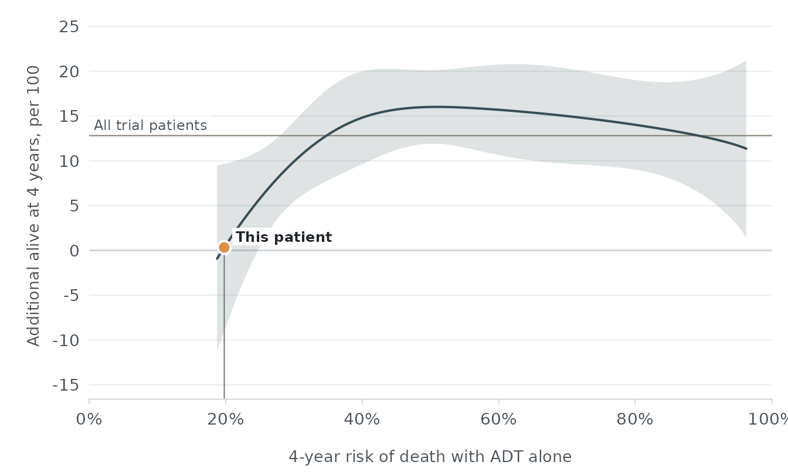

# Get started with mhspcarpi

mhspcarpi scores patients with metastatic hormone-sensitive prostate
cancer (mHSPC) on a risk model developed from individual participant
data of 4 placebo-controlled randomized clinical trials of androgen
receptor pathway inhibitors (ARPIs). For each patient it returns:

- the risk of death within 4 years with placebo plus androgen
  deprivation therapy (ADT), called baseline risk; and
- the pooled treatment effects of an ARPI plus ADT versus placebo plus
  ADT at that baseline risk, each with a 95% confidence interval and a
  95% prediction interval.

``` r

library(mhspcarpi)
```

## Inputs

[`model_inputs()`](https://wfukuokaya.github.io/mhspcarpi/reference/model_inputs.md)
lists the 9 inputs, the column names expected in a data frame, the
units, and what to enter.

``` r

inputs <- model_inputs()
inputs[c("name", "unit", "accepted", "scoring")]
#>                  name  unit                                            accepted
#> 1             ecog_ps  <NA>                                             0, 1, 2
#> 2       gleason_score  <NA>                          2, 3, 4, 5, 6, 7, 8, 9, 10
#> 3 visceral_metastasis  <NA>                                                0, 1
#> 4     bone_metastases count Count, or category code "0-3", "4-6", "7-10", "11+"
#> 5                 psa ng/mL                                        0 to 100,000
#> 6          hemoglobin   g/L                                           20 to 250
#> 7             albumin   g/L                                            10 to 70
#> 8                 alp   U/L                                         0 to 10,000
#> 9                 ldh   U/L                                         0 to 10,000
#>                                                                                 scoring
#> 1                                                                           0 vs 1 or 2
#> 2                                                                         ≤8 vs 9 or 10
#> 3                                                             Absent (0) or present (1)
#> 4                                                        Categories 0–3, 4–6, 7–10, ≥11
#> 5 Restricted cubic spline; trial data 0 to 19,000; values above 8,322 scored at the cap
#> 6                                         Restricted cubic spline; trial data 57 to 186
#> 7                                        Restricted cubic spline; trial data 24 to 61.5
#> 8 Restricted cubic spline; trial data 26 to 7,680; values above 4,824 scored at the cap
#> 9 Restricted cubic spline; trial data 67 to 4,124; values above 1,470 scored at the cap
```

The package includes 6 synthetic patients that span the range of
baseline risk.

``` r

example_patients
#>   patient_id ecog_ps gleason_score visceral_metastasis bone_metastases psa
#> 1         P1       0             7                   0               0   5
#> 2         P2       0             8                   0               2  12
#> 3         P3       0             9                   0               8  45
#> 4         P4       1             9                   0              15 150
#> 5         P5       1             8                   1               5  30
#> 6         P6       2            10                   1              30 800
#>   hemoglobin albumin alp ldh
#> 1        150      46  70 160
#> 2        142      44  80 170
#> 3        128      41 180 210
#> 4        115      38 420 280
#> 5        120      36 150 320
#> 6        105      34 500 350
```

## Baseline risk

[`predict_baseline_risk()`](https://wfukuokaya.github.io/mhspcarpi/reference/predict_baseline_risk.md)
returns one row per patient. The `notes` column reports values outside
the range observed in the trials and baseline risks outside the range in
which treatment effects were estimated.

``` r

risk <- predict_baseline_risk(example_patients)
risk
#>   row linear_predictor baseline_risk in_effect_range
#> 1   1       -0.9130882     0.1555849           FALSE
#> 2   2       -0.6475616     0.1979137            TRUE
#> 3   3        0.5761384     0.5275000            TRUE
#> 4   4        1.4173830     0.8242210            TRUE
#> 5   5        1.2584077     0.7730558            TRUE
#> 6   6        2.0277171     0.9592382            TRUE
#>                                                                                                                                             notes
#> 1 Baseline risk is outside the range in which treatment effects were estimated (19% to 96%); effects are shown at the nearest edge of that range.
#> 2                                                                                                                                            <NA>
#> 3                                                                                                                                            <NA>
#> 4                                                                                                                                            <NA>
#> 5                                                                                                                                            <NA>
#> 6                                                                                                                                            <NA>
```

## Treatment effects

[`estimate_treatment_effect()`](https://wfukuokaya.github.io/mhspcarpi/reference/estimate_treatment_effect.md)
returns the effects at each patient’s baseline risk in long format. The
`ard` scale is the difference in the probability of being alive at 4
years, `rmst` is the difference in restricted mean survival time through
4 years in months, and `hr` is the hazard ratio for death.

``` r

effects <- estimate_treatment_effect(example_patients, scale = c("ard", "rmst"))
effects[c("row", "baseline_risk", "scale", "estimate", "conf_low", "conf_high")]
#>    row baseline_risk scale     estimate    conf_low  conf_high
#> 1    1     0.1555849   ard -0.009148616 -0.11314296 0.09484573
#> 2    1     0.1555849  rmst  0.522817473 -1.68428270 2.72991764
#> 3    2     0.1979137   ard  0.003334344 -0.08994206 0.09661075
#> 4    2     0.1979137  rmst  0.607792586 -1.36662444 2.58220961
#> 5    3     0.5275000   ard  0.160044393  0.11780614 0.20228265
#> 6    3     0.5275000  rmst  4.316026384  3.14596907 5.48608369
#> 7    4     0.8242210   ard  0.137412348  0.08649917 0.18832552
#> 8    4     0.8242210  rmst  4.553175470  2.76740957 6.33894137
#> 9    5     0.7730558   ard  0.143118134  0.09281376 0.19342251
#> 10   5     0.7730558  rmst  4.903008734  3.35721259 6.44880487
#> 11   6     0.9592382   ard  0.114637434  0.01840863 0.21086624
#> 12   6     0.9592382  rmst  2.961227900 -0.96782352 6.89027932
```

Patients whose baseline risk falls outside the 1st to 99th percentiles
of the trials receive the effect at the nearest edge of that range, with
`in_effect_range` set to `FALSE`.

## Checking data before scoring

[`check_inputs()`](https://wfukuokaya.github.io/mhspcarpi/reference/check_inputs.md)
stops with an informative error when a value is missing or impossible,
and returns warnings and notes for values outside the trial range.

``` r

check_inputs(data.frame(example_patients[1, ], hemoglobin = -1))
#> [1] row      input    severity message 
#> <0 rows> (or 0-length row.names)
```

## Plotting

[`plot_treatment_effect()`](https://wfukuokaya.github.io/mhspcarpi/reference/plot_treatment_effect.md)
draws the pooled effect across baseline risk, with the patients in
`newdata` marked.
[`treatment_effect_curve()`](https://wfukuokaya.github.io/mhspcarpi/reference/treatment_effect_curve.md)
returns the plotted curve for custom figures.

``` r

plot_treatment_effect(example_patients[2, ], scale = "ard")
```



``` r

curve <- treatment_effect_curve("rmst")
head(curve)
#>   linear_predictor baseline_risk scale  estimate   conf_low conf_high  pred_low
#> 1       -0.7083770     0.1874087  rmst 0.5228175 -1.6842827  2.729918 -4.921992
#> 2       -0.6804668     0.1921675  rmst 0.5618153 -1.5374800  2.661111 -4.624828
#> 3       -0.6525567     0.1970319  rmst 0.6008132 -1.3922767  2.593903 -4.330827
#> 4       -0.6246465     0.2020034  rmst 0.6398111 -1.2489425  2.528565 -4.040507
#> 5       -0.5967364     0.2070835  rmst 0.6788089 -1.1078051  2.465423 -3.754493
#> 6       -0.5688262     0.2122737  rmst 0.7178068 -0.9692634  2.404877 -3.473547
#>   pred_high
#> 1  5.967627
#> 2  5.748459
#> 3  5.532453
#> 4  5.320129
#> 5  5.112111
#> 6  4.909160
```

## The calculator

[`run_app()`](https://wfukuokaya.github.io/mhspcarpi/reference/run_app.md)
opens the interactive calculator. The same app is exported as a static
Shinylive site with `tools/build_shinylive.R`, so it runs entirely in
the browser without a server. The calculator accepts the inputs in its
query string, for example `?psa=45&hemoglobin=128`, using the column
names and units listed by
[`model_inputs()`](https://wfukuokaya.github.io/mhspcarpi/reference/model_inputs.md).

## Model specification

The model is stored as aggregate parameters in a JSON file installed
with the package. No participant-level data are included.

``` r

mhspc_model()
#> mHSPC ARPI treatment-effect model (260803-raw-rcs)
#> • Baseline risk: All-cause death within 4 years with Placebo plus ADT.
#> • Inputs: ecog_ps, gleason_score, visceral_metastasis, bone_metastases, psa,
#>   hemoglobin, albumin, alp, and ldh.
#> • Treatment effects of ARPI plus ADT: survival difference, restricted mean
#>   survival time difference, and hazard ratio.
#> • Baseline hazards from 100 imputed datasets.
```

The specification is at
`system.file("extdata", "model_spec.json", package = "mhspcarpi")`.
